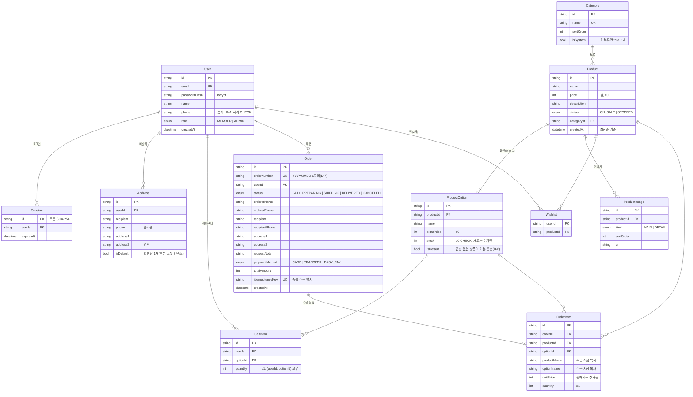

# 굿즈샵 ERD (7단계)

> 원본은 Notion "굿즈 쇼핑몰 > 06. 기술 설계"(API는 "03. API 명세서", ERD 그림은 ERDCloud)다. 이 파일은 사본이며, 내용이 다르면 Notion을 따른다.

ERD 그림: https://www.erdcloud.com/d/sAq6RaTzyR2EfSxY9

원본은 `prisma/schema.prisma`, 제약은 `prisma/migrations/*_constraints/migration.sql`. PRD 6장의 원문 7개 엔티티(회원·상품·상품 옵션·장바구니·주문·주문 상품·찜)에 D-14의 추가(배송지·카테고리·상품 이미지, 주문·상품·회원 필드)와 로그인 세션을 더했다.

## 규칙 ↔ 데이터

| PRD | 데이터 구현 |
|---|---|
| D-6 옵션 없는 상품 | `ProductOption.isDefault = true` 1개 자동 생성 |
| D-7 주문 번호 | `Order.orderNumber` 고유 |
| D-8·U-04 기본 배송지 | `Address.isDefault` + 부분 고유 인덱스 `Address_one_default_per_user` |
| D-11 옵션 단위 재고 | `ProductOption.stock`만, CHECK ≥ 0 |
| D-12 미분류 | `Category.isSystem` + 부분 고유 인덱스 `Category_one_system` |
| 6장 주문 시점 복사 | `OrderItem.productName·optionName·unitPrice`, `Order`의 배송지 필드 |
| 6장 멱등 키 | `Order.idempotencyKey` 고유 |
| v1.4 연락처 | `User/Address/Order` 연락처 CHECK `^[0-9]{10,11}$` |
| 주문 이력 상품 삭제 금지(A-02) | `OrderItem.productId` FK(삭제 제한) → 서버는 판매 중지만 허용 |
| 주문 이력 옵션 삭제 금지(A-04, PRD v1.7) | `OrderItem.optionId` FK(삭제 제한) → 서버가 409, 재고 0으로만 정리. `CartItem.optionId`는 연쇄 삭제 |
| 삭제 동작 | 연쇄 삭제: 회원→세션·배송지·장바구니·찜, 상품→이미지·옵션·찜, 옵션→장바구니, 주문→주문 상품. 삭제 제한: 주문 상품→상품·옵션, 상품→카테고리, 주문→회원 |

## 시드(prisma/seed.ts)
카테고리 6 + 미분류, 상품 15(판매 중 13·판매 중지 2), 옵션 21(품절 옵션·전체 품절 상품·기본 옵션 상품 포함), 관리자 `admin@goodsshop.test`·회원 `goods@example.com`(개발용 비밀번호는 개발 환경 문서 참고).
